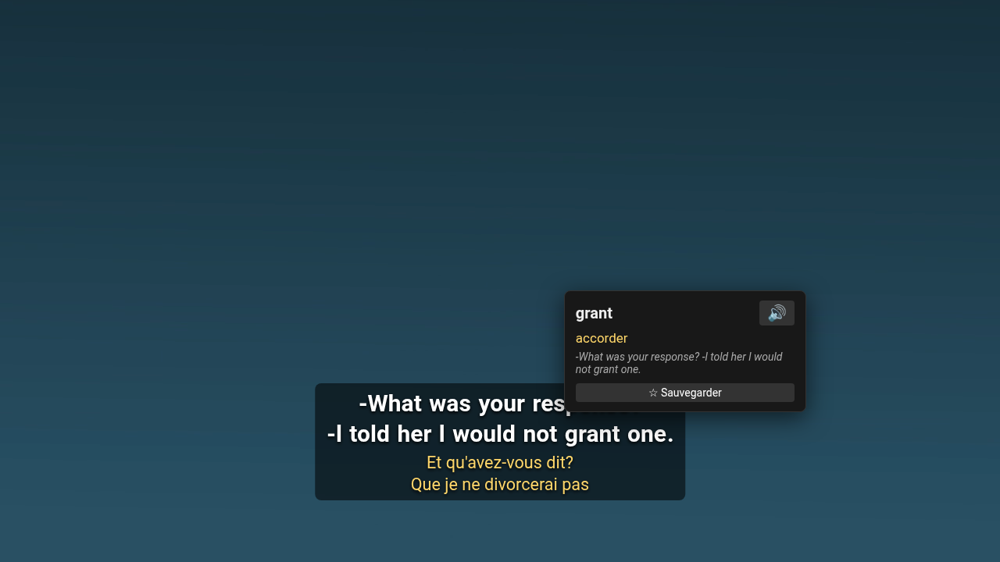
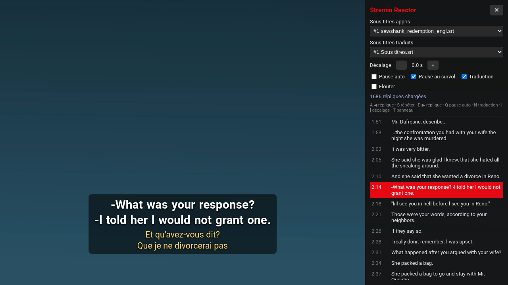

# Stremio Reactor

Apprendre une langue en regardant des films et séries sur **Stremio**, façon Language Reactor : sous-titres doubles, mots cliquables, pause automatique.

Deux parties :

| | Où | Fonctions |
|---|---|---|
| **Extension Chrome** | Stremio Web (`web.stremio.com`) | double sous-titres, mots cliquables, pause auto, transcript, mots sauvegardés |
| **Addon Stremio** | application Stremio (PC, et tout appareil si hébergé) | double sous-titres fusionnés en une piste |

Langues : anglais, français, espagnol, allemand, italien, portugais, arabe, russe, turc, néerlandais, polonais, japonais, coréen, chinois.

## Captures

**Extension** : clic sur un mot pour le traduire, l'écouter ou le sauvegarder.



**Extension** : panneau avec choix des pistes, réglages et transcript cliquable (touche T).



**Addon** : rendu dans le lecteur de l'application (anglais + français, anglais + arabe).


## Extension Chrome

### Installation

1. Ouvre `chrome://extensions` et active le **Mode développeur**.
2. Clique sur **Charger l'extension non empaquetée** et choisis ce dossier.
3. Clique sur l'icône de l'extension pour choisir ta langue apprise et ta langue maternelle.
4. Dans le lecteur Stremio, **désactive les sous-titres intégrés** pour ne pas avoir deux fois le texte.

Pour lire les torrents et les fichiers MKV dans le navigateur, Stremio Web a besoin de **Stremio Service** (ou de l'application ouverte) sur ton PC.

### Raccourcis (dans le lecteur)

| Touche | Action |
|---|---|
| A / D | réplique précédente / suivante |
| S | répéter la réplique |
| Q | activer ou désactiver la pause auto |
| N | afficher ou masquer la traduction |
| [ / ] | décaler les sous-titres de −/+ 0,25 s |
| T | panneau : choix de piste, transcript, réglages |
| Échap | fermer la bulle du mot |

Les mots sauvegardés apparaissent en vert dans les sous-titres et s'exportent pour Anki depuis la fenêtre de l'extension.

## Addon pour l'application Stremio

L'application lit les vidéos avec mpv, donc l'extension n'y fonctionne pas. L'addon fusionne la langue apprise et la traduction (en jaune) dans une seule piste de sous-titres.

1. Lance `node addon/server.js` (Node 18 ou plus récent, sans dépendance).
2. Dans Stremio → Addons, colle `http://127.0.0.1:7070/en-fr/manifest.json` dans la barre de recherche. Pour d'autres langues, remplace `en-fr` (`en-ar`, `fr-ar`, `es-fr`…) ou génère l'adresse sur <http://127.0.0.1:7070>. N'utilise pas de lien `stremio://` : Stremio le transforme en https et perd le port.
3. Dans le lecteur, menu sous-titres, choisis :
   - **EN+FR 1 / 2 / 3** : vrais sous-titres traduits, recalés automatiquement sur la langue apprise (décalage et fréquence d'images) ;
   - **EN+FR auto** : traduction automatique, toujours synchronisée.

### Démarrage automatique (Linux, systemd)

Adapte les chemins dans `addon/stremio-reactor.service`, puis :

```bash
mkdir -p ~/.config/systemd/user && cp addon/stremio-reactor.service ~/.config/systemd/user/ && systemctl --user enable --now stremio-reactor
```

## Sources des données

- Sous-titres : addon officiel **OpenSubtitles v3** de Stremio.
- Traductions : service de traduction de Google (repli sur MyMemory).

## Développement

Page de test qui imite le lecteur Stremio, sans installer l'extension :

```bash
ffmpeg -f lavfi -i testsrc=size=480x270:rate=10 -t 240 -pix_fmt yuv420p dev/test.mp4
python3 dev/server.py
```

Puis ouvre <http://127.0.0.1:8765/dev/test.html>.

Les captures du dossier `docs/` se régénèrent avec `node dev/screenshots.mjs` (Chrome, page de test et addon lancés, vidéo `dev/demo.mp4`).
